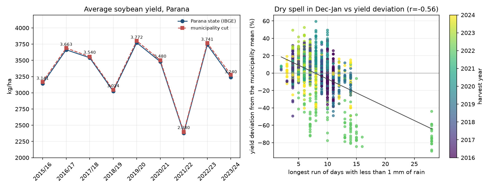

# safra

A warehouse over public data that answers one question per municipality and per harvest season:
**does drought explain soybean yield in Paraná?**



Nine seasons (2015/16 → 2023/24), 192 municipalities covering 85% of the state's soybean area,
1,728 municipality × season rows. Everything comes from two public APIs: the IBGE agricultural
survey (PAM, table 1612) and NASA POWER daily weather for each municipal centroid.

The answer is not the one I expected:

| predictor | correlation with yield | |
|---|---|---|
| total rainfall, Sep–Apr | **−0.07** | says nothing |
| rainfall, Dec–Jan | +0.34 | flowering and grain filling |
| longest dry spell, Dec–Jan | **−0.56** | one extra dry day = −3.1% yield |
| rain + dry spell in Dec–Jan | R² **0.35** | the model in `report.py` |

The 2021/22 season makes the point by itself: 42% less rain than the municipality's average in
that window, 79% of municipalities in the two driest bands, and 2.380 kg/ha against 3.741 kg/ha
the following season.

## Run it

```
make install
make demo
```

First run downloads the data (192 weather requests, throttled, ~8 min) and then everything is
cached on disk. A second run rebuilds the whole warehouse in about 40 seconds, no network:

```
[safra] sql 04_silver_clima.sql (0.45s)
...
[safra] check ok   cobertura_area: 0.8427 (esperado >= 0.80)
[safra] check ok   janela_clima_completa: 1.0 (esperado >= 0.98)
season      IBGE    cut  cover  rain anom  dry spell  % dry
2015/16     3141   3169   85%     43.6%      10.2d     0%
...
2021/22     2380   2396   84%    -42.5%      10.8d    79%
model: deviations inside each municipality, 1728 obs / 192 municipalities
  corr rain (Dec-Jan)     = +0.34   (+10 p.p. rain  -> +1.2% yield)
  corr dry spell (Dec-Jan)= -0.56   (+1 dry day     -> -3.1% yield)
  R2                      = 0.35
```

Options: `--anos 2018-2024`, `--cobertura 0.6` (how much of the state's planted area to cover),
`--municipios all` (all 399 municipalities, ~30 min of downloads), `--force` (ignore cache).
`python -m safra ingest|build|check|report` runs one stage at a time.

Data is not committed. `data/bronze/` fills up with the raw API payloads on first run and
`data/_manifest.jsonl` records every request (url, sha256, bytes, timestamp).

## What is in the box

```
src/safra/ingest/     SIDRA and NASA POWER clients (cache, throttle, retry, atomic write)
src/safra/transform/  warehouse.py + 8 SQL files: silver (typed) and gold (dimensional)
src/safra/quality/    six checks, each returning the measured value and the threshold
src/safra/report.py   terminal table, CSVs into dist/, the figure above
src/safra/pipeline.py one function per stage
dags/safra_dag.py     Airflow DAG that only wires those functions
tests/                16 tests, all offline, against trimmed real API payloads
```

`docs/arquitetura.md` for the layer contract and the S3/Athena mapping,
`docs/decisoes.md` for the seven decisions that shaped it (in Portuguese),
`docs/dados.md` for the data dictionary and the known limits.

## Checks

Six checks run before publishing, and the run exits non-zero if any fails:

| check | what it catches |
|---|---|
| `grao_unico` | duplicated municipality × season in the fact table |
| `rendimento_na_faixa` | 300–6000 kg/ha; outside that it is a unit error in the source |
| `chuva_na_faixa` | 50–1500 mm in Dec–Jan |
| `cobertura_area` | the municipality cut covering less than 80% of the state's area |
| `recorte_sem_vies` | production share drifting away from area share — a biased cut |
| `janela_clima_completa` | a season window with missing days hiding inside an average |

The last two are the ones that matter: they are the difference between a pipeline that runs and
one that can be trusted to say what it says.

## Limits

* NASA POWER is a 0.5° reanalysis grid (~55 km). Neighbouring municipalities share a cell, so the
  rainfall is "the cell containing the municipal centroid", not the municipality.
* 192 of 399 municipalities are in the fact table. The remaining 15% of the area is not, and the
  reconciliation table says so out loud (`gold.reconciliacao_safra`).
* Rainfall under 1 mm/day counts as dry. POWER's daily value is a spatial average, so a local
  shower reads as a fraction of a millimetre.
* R² = 0.35 means climate is one third of the story. Planting date, cultivar, soil management,
  credit and ENSO are not in the model — see `docs/decisoes.md` (D6).
* The PAM revises past years. Rebuilding from bronze changes history: there is no `valid_from`
  column, and that is a deliberate scope cut, not an oversight.

## Notas em português

Os comentários e as decisões (`docs/decisoes.md`) estão em português porque o domínio é brasileiro
— "safra", "veranico", "rendimento" não têm tradução que diga a mesma coisa. O README está em
inglês porque é a língua da maior parte das vagas para as quais este repositório serve.

Nada aqui é código de empresa: as fontes são públicas (IBGE e NASA) e o que veio da experiência
profissional foi o desenho (camadas em arquivo, orquestração, reconciliação contra o total
oficial), não linha de código.

MIT.
